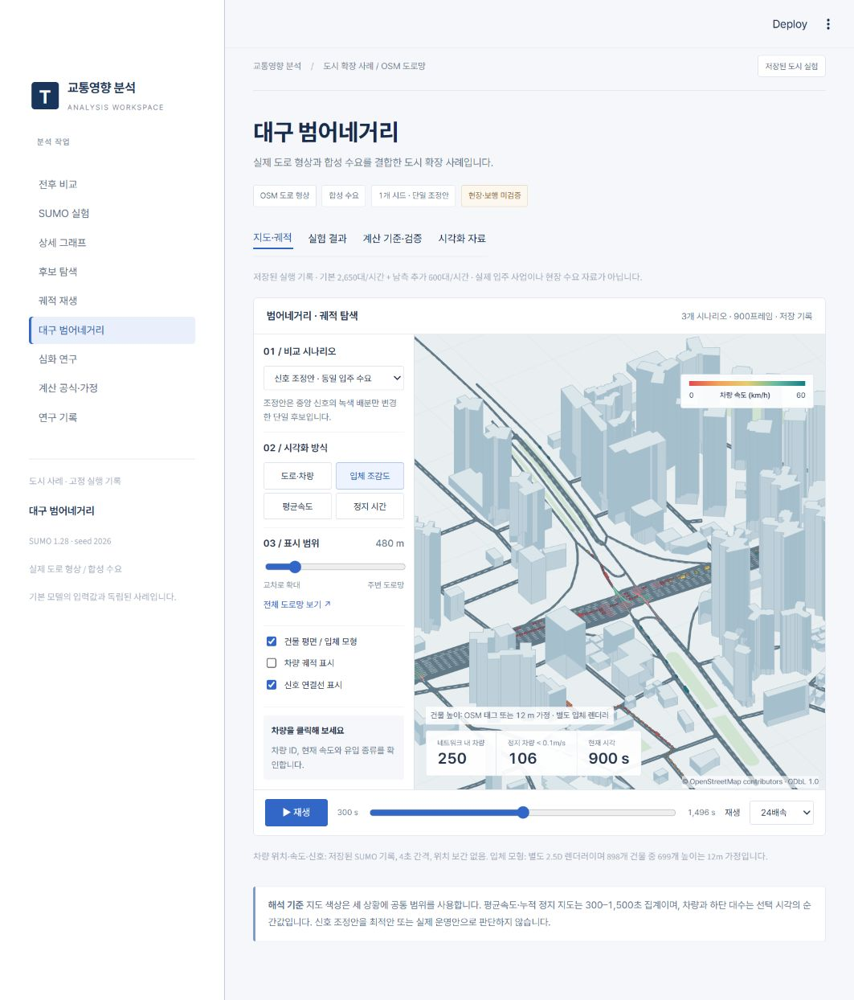

# 교통영향 분석 · Python + Streamlit + SUMO

아파트 입주 전·후·신호 조정 후보를 같은 조건으로 비교하는 연구용 웹 앱입니다. 가상의 4지 직진 교차로가 기본이며, 회전 교차로·인접 교차로·공개 차량 궤적 비교는 별도 연구입니다. 학습형 AI 모델은 사용하지 않았습니다. AI 개발 도우미와 SUMO를 활용한 계산·실험·후보 열거 프로젝트입니다.

## 처음 방문했다면

- **코드 살펴보기:** 아래 파일 안내에서 `app.py` → `traffic/models.py` → `traffic/ui_research.py` 순서로 시작하세요.
- **완성본 실행:** [전체 실험 패키지 다운로드](https://github.com/Jino-222/traffic-simulation/releases/tag/v3.0.0-daegu)에서 `traffic-impact-research-v3-daegu.zip`을 받아 압축을 풀고 `setup.cmd` → `run.cmd` 순서로 실행하세요.
- **Git으로 받기:** `git clone https://github.com/Jino-222/traffic-simulation.git` 후 해당 폴더에서 같은 방법으로 설치·실행할 수 있습니다. 저장소 접근 권한이 있는 GitHub 계정으로 로그인해야 합니다.

저장소에는 앱 코드, 저장 결과·상세 그래프·기본 궤적·범어네거리 재생에 필요한 자료가 포함되어 있습니다. 원시 기록 중 `experiments` 아래의 반복 출력 `e2.xml`, `summary.xml`, `tripinfo.xml`, `fcd.xml.gz`만 전체 Release ZIP에서 제공합니다. **범어네거리의 동결 원본 92개 파일은 저장소에도 그대로 포함**됩니다. 수록 범위와 전체 ZIP 해시는 `docs/github_distribution.json`에서 확인할 수 있습니다.

### 코드를 읽는 순서

| 파일·폴더 | 확인할 내용 |
|---|---|
| `app.py` | 앱 시작점, 입력과 화면 메뉴 연결 |
| `traffic/models.py` | 교통량·차로·신호 조건의 자료 구조 |
| `traffic/`의 계산·검증 모듈 | 처리능력·v/c와 신호·보행시간 검사 |
| `traffic/sumo/` | 도로망·수요 생성과 SUMO 실행 |
| `traffic/ui_research.py`, `traffic/dashboard.py` | 저장 실험 조회와 결과 그래프 |
| `traffic/search.py` | 후보 배분 탐색, 중단·재시도 |
| `traffic/city.py`, `traffic/ui_city.py` | 범어네거리의 집단별 집계와 화면 |
| `frontend/replay.js`, `frontend/city.js` | 실제 기록 기반 궤적 재생과 지도 |
| `tests/` | 계산·실행·화면·집계 확인 방법 |
| `docs/contributions.md` | 개발 도구·AI 활용·검토 범위 |



OSM 형상: © OpenStreetMap contributors, [ODbL 1.0](https://www.openstreetmap.org/copyright). 수요와 일부 건물 높이는 가정입니다.

## Windows에서 설치와 실행

1. Python 3.11과 Python launcher가 설치된 Windows에서 ZIP을 풀거나 저장소를 clone합니다.
2. `setup.cmd`를 실행합니다. 인터넷을 통해 `requirements-lock.txt`의 검증한 전체 의존성 버전을 설치합니다. 이 파일이 없을 때만 `requirements.txt`를 사용합니다. Python 환경은 `%LOCALAPPDATA%\TrafficImpactLab\venv`에 생성하며 기존 환경이 있으면 재사용합니다.
3. `run.cmd`를 실행합니다. 브라우저에서 http://127.0.0.1:8502 를 엽니다.
4. 이미 이 포트에서 앱이 실행 중이면 기존 화면을 사용합니다. 별도 사본은 아래 명령의 포트를 변경합니다.

```powershell
& "$env:LOCALAPPDATA\TrafficImpactLab\venv\Scripts\python.exe" -m streamlit run app.py --server.address 127.0.0.1 --server.port 8503
```

별도의 SUMO GUI 설치 없이 `eclipse-sumo`, `sumolib`, `traci` 패키지를 사용합니다. 앱은 로컬 컴퓨터에서 실행하며 외부 공개 배포를 하지 않습니다. 기본 모델 입력과 저장 실험은 합성 데이터입니다.

## 처음 사용할 때

1. **전후 비교**: 기본값에서 총 교통량 2,000→2,600대/시간, 신호40/40→후보50/30초의 공식 기반 용량과 v/c를 봅니다. 입력은 즉시 계산됩니다.
2. **SUMO 실험**: 왼쪽 ‘SUMO 실험 시간·재현성’에서 ‘빠른 확인’ 또는 1시간 실험을 선택하고 ‘세 시나리오 SUMO 실행’을 누릅니다. 입력을 바꿔도 저장 결과는 자동으로 다시 실행되지 않습니다.
3. **상세 그래프**: 저장 실험을 골라 방향별 불이익, 완료 상태, 시간 변화·분포·신호·대기행렬을 확인합니다. `baseline_v2`는 1시간 기준 사례입니다.
4. **후보 탐색**: `study_v2/discovery`의 31개 배분과 별도 검증을 볼 수 있습니다. 새 탐색은 ‘현재 조건으로 전체 후보 탐색’으로 시작합니다. 중단·이어 실행·실패 재시도를 지원합니다.
5. **궤적 재생**: `baseline_v2` 또는 `selected_replay_701`을 고릅니다. 두 상황을 같은 시각으로 재생하고 배속·시각 이동·차량 선택을 사용합니다. 새 실험은 ‘SUMO 궤적 저장’을 켜야 궤적과 위치 기반 대기행렬이 생성됩니다.
6. **심화 연구**: 공개 추종 자료, 보행 형상, 회전·인접 교차로, 대기행렬 검증을 확인합니다. 이 화면은 저장된 별도 연구이며 왼쪽 기본 입력에 따라 재실행되지 않습니다.
7. **대구 범어네거리**: 지도·궤적, 실험 결과, 계산 기준·검증, 시각화 자료를 선택합니다. OSM 형상 위 합성 수요로 실행한 고정 사례입니다. 기본 모델 입력과 독립적이며 이 화면에서는 재실행하지 않습니다. 전체 출발 요청과 관측기간 출발 예정 집단을 구분하며, 기본 모델의 후보 순위에 합산하지 않습니다.
8. **연구 기록**: 보고서를 선택해 읽거나 저장하고, 실제 SUMO 기록의 시연 영상을 재생합니다. 범어네거리 통합 기록에서 이번 변경·검증 범위를 확인하세요.

## 해석할 때 확인할 것

- 공식 용량: 차로 수 × 포화교통류율 × 유효녹색/주기. 공식의 포화교통류율을 SUMO 차량 동작에 자동 적용하지 않습니다.
- SUMO 시간 손실·정차대기시간은 공식 제어지체나 LOS가 아닙니다. 관측기간 출발 예정 집단 중 종료까지 **완료한 차량**의 평균입니다. 미진입·미완료가 남으면 평균만으로 개선을 판단하지 않습니다.
- 기본 실험은 준비900초·관측3600초·추가종료900초입니다. 누적 그래프는 준비기간을 포함하고, 관측기간 그래프는 별도 표시합니다.
- 한 방향의 개선이 다른 방향의 악화를 만들 수 있습니다. 전체 평균 기준과 최악 방향 기준을 함께 확인합니다.
- 대기행렬은 위치 기반 최장 연속 정지 차량군입니다. E2 원자료 길이는 별도 보존하며 같은 지표로 표시하지 않습니다. 검지 경계·기록 주기·정지 판정의 한계가 있습니다.
- 실제 도로 적용·교통안전 판단·공식 교통영향평가용으로 검증한 프로그램이 아닙니다.

## 저장된 주요 연구

| 연구 | 근거 폴더 | 결과 범위 |
|---|---|---|
| 31개 신호 배분 × 3시드 | `experiments/study_v2/discovery` | 전체 평균49/31초·방향 균형44/36초 선택 |
| 선택 고정 후 새 시드3개 | `experiments/study_v2/holdout` | 평균 차이 각각−2.558초·−1.499초, 방향별 악화 존재 |
| 16개 시나리오 | `experiments/study_v2/scenarios` | 시드407 민감도; baseline과 irregular 중복 조건을 명시 |
| 규칙 도착 대조 | `experiments/arrival_control_regular` | 불규칙 도착과 총량을 맞춘 대조 |
| 공개 추종 자료 | `experiments/public_calibration_v2` | 24조합 보정, 별도10대 검증; 기준값 대비 추가 개선 없음 |
| 회전·인접 교차로 | `experiments/network_study_v1` | 회전안 악화, 시차11초의 별도 검증 평균−1.702초 |

모두 제한된 실험 조건의 결과이며 다른 도로·교통량에 대한 최적해나 현장 개선 효과를 뜻하지 않습니다.

## 재현과 검사

프로젝트 폴더에서 위 Python 환경을 활성화하거나 전체 Python 경로를 사용합니다.

Git checkout의 자동 검사는 `python -X utf8 -m pytest -q`로 실행합니다. 아래 원자료 감사 명령 전체는 **원시 XML이 포함된 Release ZIP을 푼 폴더**에서 실행하세요. 새 SUMO 실험과 새 후보 탐색은 Git checkout에서도 실행할 수 있습니다.

2026-11-11 GitHub 배포 사본에서 **90개 테스트 통과(58.02초)**를 확인했습니다. 결과는 `docs/github_tests.xml`에 있습니다. 기존 Windows/Python 설치 환경에서 새 경로의 사본을 검사한 결과이며 다른 컴퓨터의 신규 설치 검증과 구분합니다.

```powershell
python -m pytest -q
python -m scripts.audit_chart_values
python -m scripts.audit_profile_mix
python -m scripts.audit_completed_studies
python -m scripts.audit_network_study
python -m scripts.run_v2_study --output experiments/new_study
python -m traffic.research.network_study --output experiments/new_network_study
```

위 두 연구 명령은 새 폴더에서 전체 실험을 실행하므로 시간이 걸립니다. 같은 위치에서 완료한 동일 조건은 재사용합니다. 엔진·입력·프로토콜이 바뀌거나 다른 위치로 복사한 배포본에서 다시 연구할 때는 새 출력 폴더를 사용합니다. 과거 절대 경로와 선택 고정 해시는 출처 기록으로 보존합니다. 위 두 실행 모듈의 명령 옵션은 `--help`로 확인합니다.

## 파일 구성과 출처

- `app.py`, `traffic/ui_*.py`: 화면과 사용 흐름.
- `traffic/sumo`, `traffic/research`: 기본 SUMO 모델과 별도 심화 연구.
- `frontend`: 실제 궤적 웹 재생. `static/replays`는 실행할 때 다시 생성하므로 배포본에서 제외합니다.
- `experiments`: 입력·처리된 결과·검사·실패 기록. Git에서 생략한 대용량 원시 출력은 전체 Release ZIP에 보존합니다.
- `docs/research_report.md`, `advanced_research.md`, `network_research.md`, `profile_mix_research.md`: 결과·가정·한계.
- `docs/requirements.json`: 원래 계획의 항목별 상태와 근거. 파일 존재만으로 완료를 판정하지 않습니다.
- `docs/contributions.md`: 개발 도구, AI 활용과 검증 범위.
- `data/public/ngsim/ATTRIBUTION.md`: US DOT/FHWA NGSIM 표본의 출처·추출·변환·CC BY-SA3.0 조건. 파생 자료를 공유할 때 함께 제공합니다.
- `docs/demo/traffic_comparison.mp4`: 실제 궤적 180초를 6배속으로 재생한 30초 시연.

기존 `traffic-impact-python`, v1·v2 ZIP과 독립 범어네거리 프로젝트는 보존합니다. 이번 배포 파일은 `traffic-impact-research-v3-daegu.zip`입니다. `python -m scripts.package_release`로 재생성합니다.

전체 배포 ZIP을 재생성할 때는 원시 출력이 모두 있는 전체 Release 사본을 사용해야 합니다. Git checkout에서 위 패키징 명령을 실행해도 생략된 원시 자료가 복원되지는 않습니다. 새 실험은 새 출력 폴더에 저장하세요.

## 도시 사례와 화면 통합

- 왼쪽 작업 메뉴와 지도 중심 화면 구성의 디자인 참고: [CARTO Builder](https://docs.carto.com/carto-user-manual/maps). 로고·브랜드·소스 복제나 제휴 표시는 하지 않았습니다.
- 로컬 Pretendard Variable v1.3.9를 사용합니다. [공식 프로젝트](https://github.com/orioncactus/pretendard), SIL Open Font License: `static/fonts/OFL.txt`. 실행 시 외부 폰트 CDN에 의존하지 않습니다.
- `case_studies/daegu_beomeo/v1`: 원본 92개 파일, 가져오기 해시, 별도 집계 `derived_metrics.json`. 원본 실행과 원본 도표를 변경하지 않습니다.
- `static/daegu`: 같은 앱 주소에서 읽는 재생 JSON. 별도의 8504 서버가 필요하지 않습니다. 배포 시 `static/fonts`, `static/daegu`를 포함해야 합니다.
- 도시 원본 분석·재실행 스크립트는 보존용입니다. 새 연구는 별도 버전 폴더에서 실행하고 기존 증거를 덮어쓰지 마세요.
- `tests/test_city.py`: 예정 출발 경계, 미완료 처리, 원본 해시, 원시 tripinfo 재집계, 차트·CSV 집계 일치, 화면 이동 입력 보존을 검사합니다.
- 검증 기록: `docs/integration_tests.xml`, `docs/daegu_import_audit.json`, `docs/daegu_integration.txt`. 이전 v2 완료 기록은 당시 검증 범위로 보존합니다.

